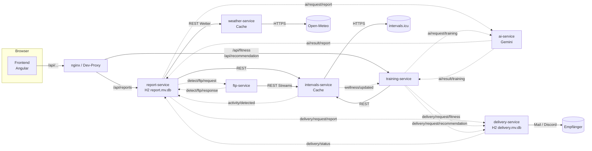
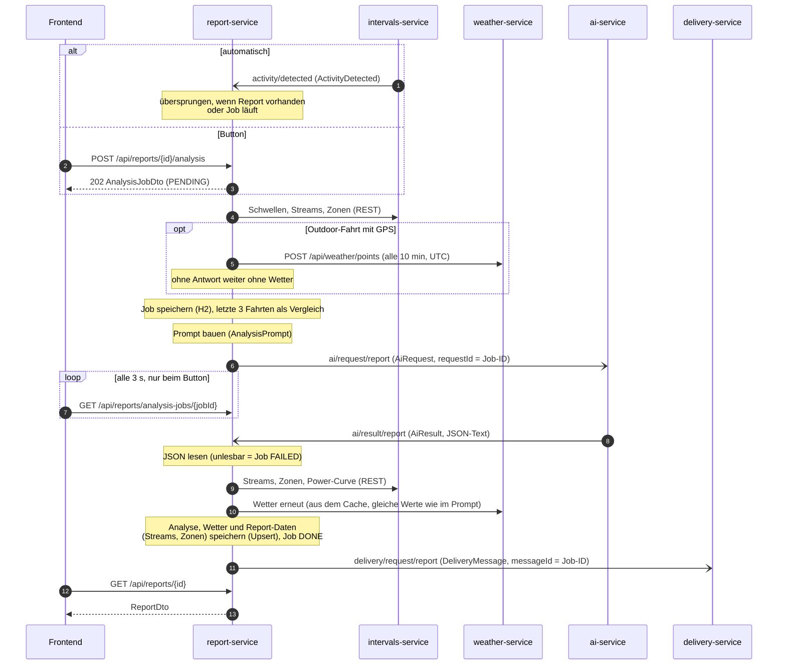
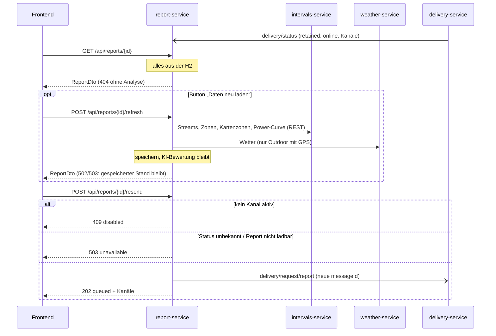
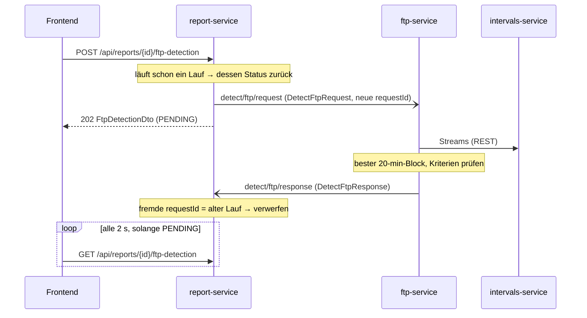
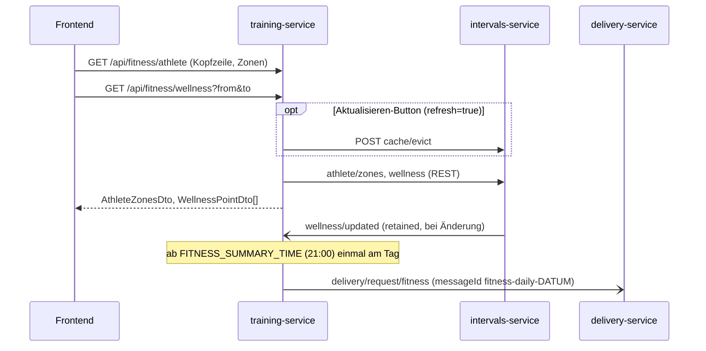
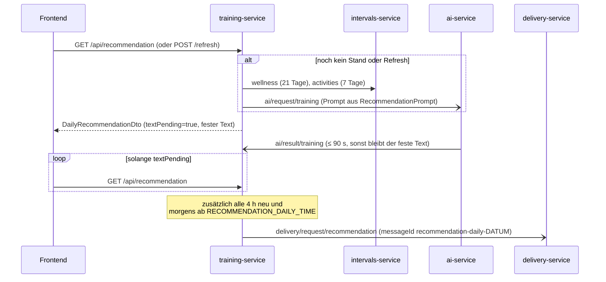

# Datenflüsse

Wie die Services zusammenspielen. Die Verträge selbst stehen in drei Quellen:

| Was | Wo |
|---|---|
| MQTT zwischen den Services | [`asyncapi.yaml`](asyncapi.yaml) (AsyncAPI 3.0), im Code `cycling-messaging` |
| REST Frontend → Services | `frontend/openapi/report-api.yaml`, `training-api.yaml` (aus springdoc erzeugt) |
| REST Services → intervals-service | Modul `intervals-api` (`IntervalsApi`, Records, gemeinsamer `IntervalsClient`) |
| REST report-service → weather-service | Modul `weather-api` (`WeatherApi`, Records, `WeatherClient`) |

Faustregel: **REST nur dort, wo das Frontend fragt** (und für Abrufe beim intervals-service), **MQTT zwischen den
Services**. Jeder Service besitzt seine Daten selbst; nur der report-service und der delivery-service haben eine
Datenbank (je eine eigene H2).

## Überblick



Durchgezogen = REST/HTTP, gestrichelt = MQTT über Mosquitto (Topics ohne Präfix `cycling/`).

## Analyse einer Fahrt

Automatisch, wenn der intervals-service eine neue Fahrt meldet, oder per Button im Kalender (Fahrt anklicken → „Mit KI analysieren“).
Beide Wege landen im selben Analyse-Job.



- Ohne Antwort nach `ANALYSIS_JOB_TIMEOUT` (15 min) wird der Job FAILED; ein spätes Ergebnis wird trotzdem übernommen.
- Rendern (QuickChart) oder Senden scheitert → Wiederholung nach 1, 5 und 15 Minuten, danach „Erneut senden“.

## Report-Seite, „Daten neu laden“ und „Erneut senden“

Ein Report kommt komplett aus der H2 (Analyse, Streams, Zonen, Kartenzonen, Power-Curve, Wetter). Anzeigen und
erneut senden klappt also auch ohne intervals-service. Nur Reports aus alter Version ohne gespeicherte Daten laden
diese beim ersten Öffnen einmal live nach.



## FTP-Test-Erkennung (ftp-service)

Nur manuell: Button „FTP-Test auswerten“ auf der Report-Seite. Das Ergebnis hängt an der Fahrt (ein Ergebnis pro
Aktivität, ein neuer Lauf überschreibt es) und wird nicht nach intervals.icu übernommen.



- Ein Block gilt als FTP-Test, wenn alle Kriterien passen: höchstens 5 % fehlende Leistungs-/Pulswerte, Leistung
  mindestens 25 % über dem Rest der Fahrt (ohne Rollen), Puls der letzten 5 min mindestens 90 % der MaxHR.
  Ohne Puls kein Test.
- FTP = 20-min-Mittel × 0,95, LTHR = mittlerer Puls im Block, MaxHR = höchstes 5-s-Mittel der ganzen Fahrt.
- Ohne Antwort nach `FTP_DETECTION_TIMEOUT` (2 min) wird der Lauf beim nächsten Abruf FAILED.

## Übersicht: Fitness und Athlet (training-service)



## Übersicht: Tagesempfehlung (training-service)

Kategorie aus der Form-Zone (dieselbe Skala wie die Fitness-Anzeige), eine Stufe lockerer bei Ramp > +6.



## REST-Endpunkte fürs Frontend

| Service | Endpoint | Zweck |
|---|---|---|
| report-service | `GET /api/reports/activities?from&to` | Aktivitätsliste mit `analyzed` |
| | `POST /api/reports/{id}/analysis` | Analyse starten (202 + Job) |
| | `GET /api/reports/analysis-jobs/{jobId}` · `GET /api/reports/{id}/analysis-job` | Job-Status |
| | `GET /api/reports/{id}` | Report |
| | `POST /api/reports/{id}/refresh` | Streams, Zonen und Wetter neu laden (ohne KI) |
| | `POST /api/reports/{id}/resend` | Versand anstoßen |
| | `POST /api/reports/{id}/ftp-detection` · `GET /api/reports/{id}/ftp-detection` | FTP-Test-Erkennung starten (202) / Ergebnis |
| training-service | `GET /api/fitness/athlete[?refresh]` | Schwellen + Zonen |
| training-service | `PUT /api/fitness/athlete/thresholds` | Schwellen + Gewicht nach intervals.icu schreiben |
| | `GET /api/fitness/wellness?from&to[&refresh]` | CTL/ATL/Form |
| | `GET /api/recommendation` · `POST /api/recommendation/refresh` | Tagesempfehlung |

Fehler vom intervals-service kommen bei beiden als ProblemDetail mit `code` an (502/503/404, ggf. `Retry-After`).

## MQTT-Topics auf einen Blick

| Topic | Von → an | Payload | Retained |
|---|---|---|---|
| `cycling/intervals/activity/detected` | intervals → report | `ActivityDetected` | nein |
| `cycling/intervals/wellness/updated` | intervals → training | `WellnessUpdated` | ja |
| `cycling/ai/request/{report,training}` | Absender → ai | `AiRequest` (fertiger Prompt) | nein |
| `cycling/ai/result/{report,training}` | ai → Absender | `AiResult` (Antworttext) | nein |
| `cycling/delivery/request/{report,fitness,recommendation}` | Absender → delivery | `DeliveryMessage` | nein |
| `cycling/delivery/status` | delivery → report | `DeliveryServiceStatus` (Last Will: offline) | ja |
| `cycling/detect/ftp/request` | report → ftp | `DetectFtpRequest` | nein |
| `cycling/detect/ftp/response` | ftp → report | `DetectFtpResponse` | nein |

Details zu Feldern, QoS und Korrelation: [`asyncapi.yaml`](asyncapi.yaml). Ansehen z. B. im
[AsyncAPI Studio](https://studio.asyncapi.com/) (Datei hineinkopieren) oder mit der AsyncAPI-CLI:

```bash
npx @asyncapi/cli validate docs/asyncapi.yaml
```

**Pflege:** Wer ein Topic oder einen Vertrag in `cycling-messaging` ändert, passt `asyncapi.yaml` und diese Seite
im selben Commit an.
