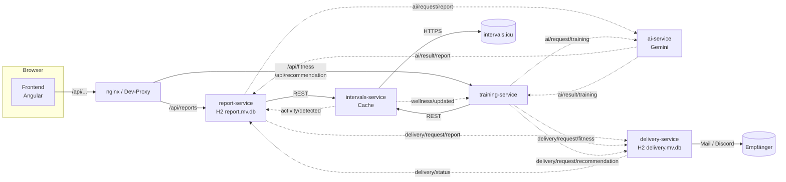
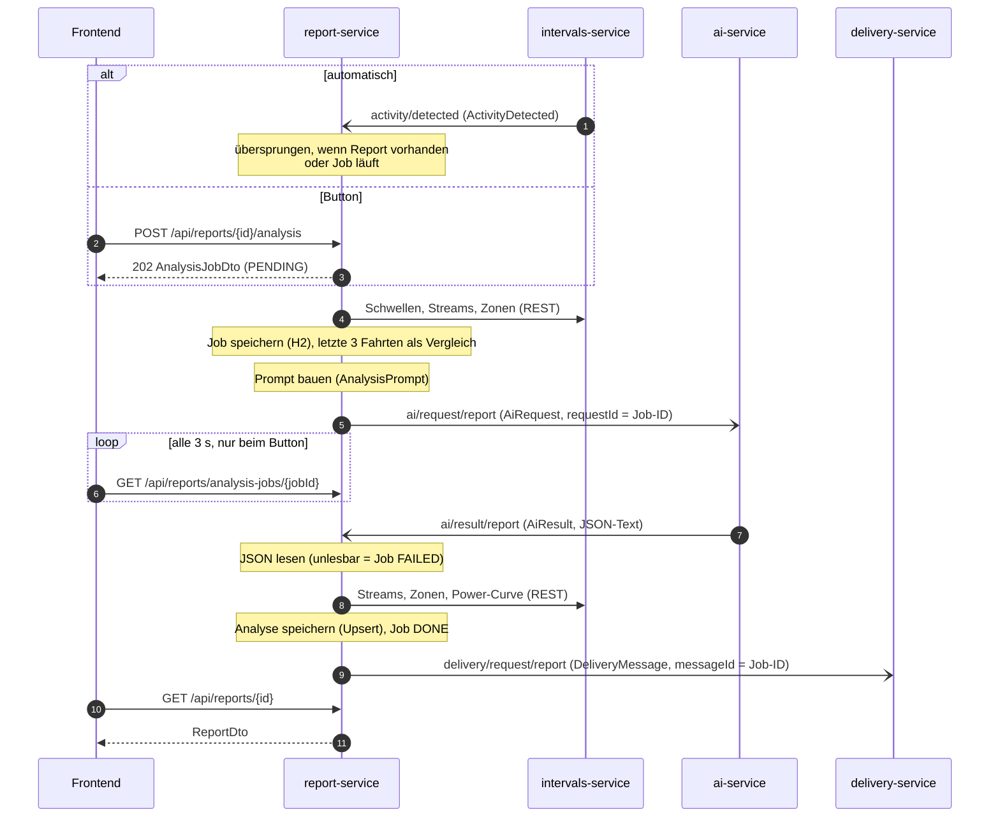
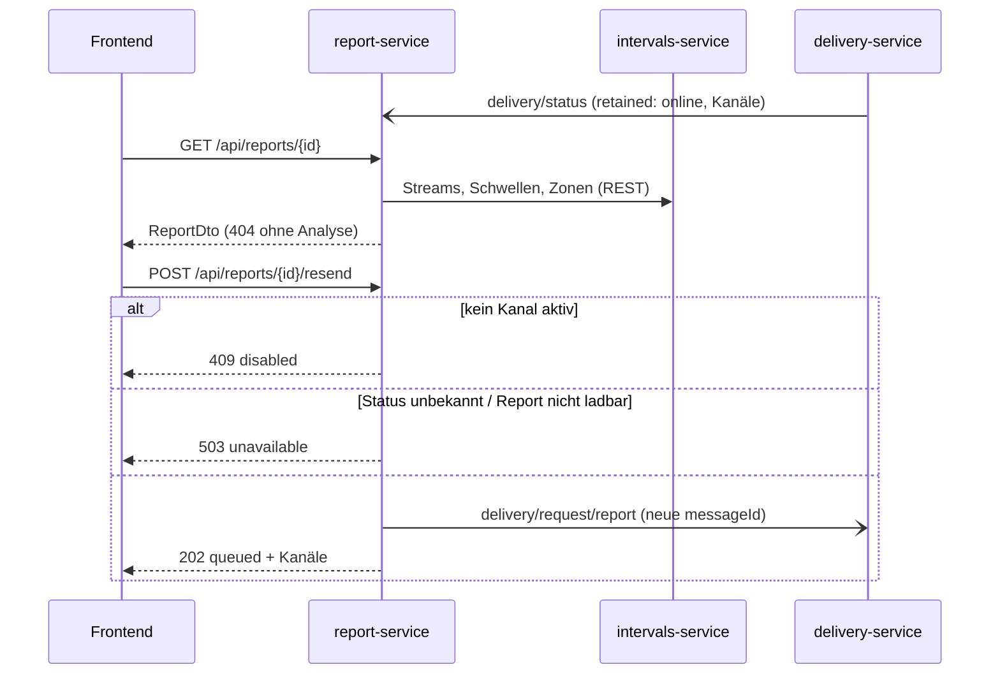
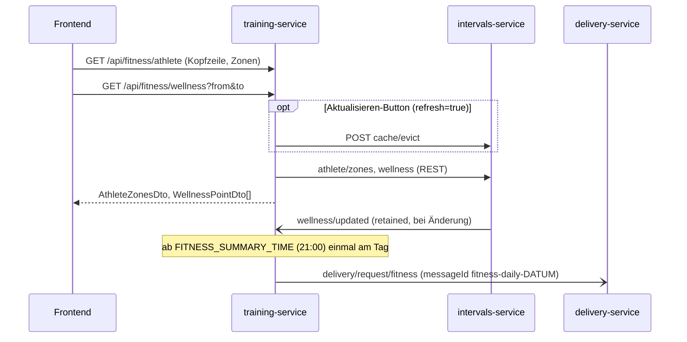
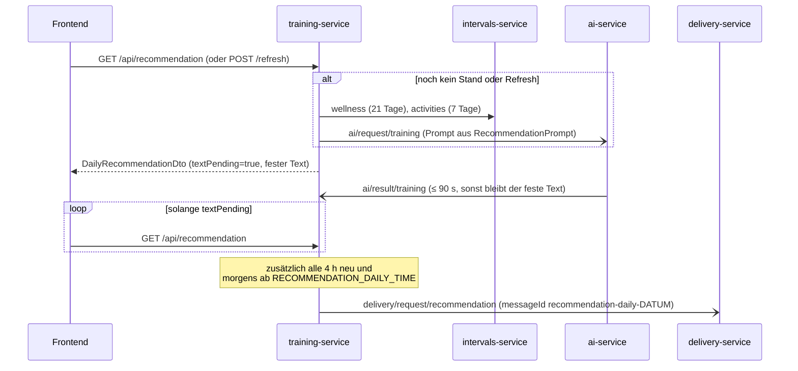

# Datenflüsse

Wie die Services zusammenspielen. Die Verträge selbst stehen in drei Quellen:

| Was | Wo |
|---|---|
| MQTT zwischen den Services | [`asyncapi.yaml`](asyncapi.yaml) (AsyncAPI 3.0), im Code `cycling-messaging` |
| REST Frontend → Services | `frontend/openapi/report-api.yaml`, `training-api.yaml` (aus springdoc erzeugt) |
| REST Services → intervals-service | Modul `intervals-api` (`IntervalsApi`, Records, gemeinsamer `IntervalsClient`) |

Faustregel: **REST nur dort, wo das Frontend fragt** (und für Abrufe beim intervals-service), **MQTT zwischen den
Services**. Jeder Service besitzt seine Daten selbst; nur der report-service und der delivery-service haben eine
Datenbank (je eine eigene H2).

## Überblick



Durchgezogen = REST/HTTP, gestrichelt = MQTT über Mosquitto (Topics ohne Präfix `cycling/`).

## Analyse einer Fahrt

Automatisch, wenn der intervals-service eine neue Fahrt meldet, oder per Button in der Aktivitätsliste.
Beide Wege landen im selben Analyse-Job.



- Ohne Antwort nach `ANALYSIS_JOB_TIMEOUT` (15 min) wird der Job FAILED; ein spätes Ergebnis wird trotzdem übernommen.
- Rendern (QuickChart) oder Senden scheitert → Wiederholung nach 1, 5 und 15 Minuten, danach „Erneut senden“.

## Report-Seite und „Erneut senden“



## Übersicht: Fitness und Athlet (training-service)



## Übersicht: Tagesempfehlung (training-service)

Kategorie aus der Form-Zone (dieselbe Skala wie die Fitness-Anzeige), eine Stufe lockerer bei Ramp > +6.



## REST-Endpunkte fürs Frontend

| Service | Endpoint | Zweck |
|---|---|---|
| report-service | `GET /api/reports/activities?from&to` | Aktivitätsliste mit `analyzed` |
| | `POST /api/reports/{id}/analysis` | Analyse starten (202 + Job) |
| | `GET /api/reports/analysis-jobs/{jobId}` · `GET /api/reports/{id}/analysis-job` | Job-Status |
| | `GET /api/reports/{id}` | Report |
| | `POST /api/reports/{id}/resend` | Versand anstoßen |
| training-service | `GET /api/fitness/athlete[?refresh]` | Schwellen + Zonen |
| | `GET /api/fitness/wellness?from&to[&refresh]` | CTL/ATL/Form |
| | `GET /api/recommendation` · `POST /api/recommendation/refresh` | Tagesempfehlung |

Fehler vom intervals-service kommen bei beiden als ProblemDetail mit `code` an (502/503/404, ggf. `Retry-After`).

## MQTT-Topics auf einen Blick

| Topic | Von → an | Payload | Retained |
|---|---|---|---|
| `cycling/intervals/activity/detected` | intervals → report | `ActivityDetected` | nein |
| `cycling/intervals/wellness/updated` | intervals → training | `WellnessUpdated` | ja |
| `cycling/ai/request/{report,training}` | Absender → ai | `AiRequest` (fertiger Prompt) | nein |
| `cycling/ai/result/{report,training}` | ai → Absender | `AiResult` (Antworttext) | nein |
| `cycling/delivery/request/{report,fitness,recommendation}` | Absender → delivery | `DeliveryMessage` | nein |
| `cycling/delivery/status` | delivery → report | `DeliveryServiceStatus` (Last Will: offline) | ja |

Details zu Feldern, QoS und Korrelation: [`asyncapi.yaml`](asyncapi.yaml). Ansehen z. B. im
[AsyncAPI Studio](https://studio.asyncapi.com/) (Datei hineinkopieren) oder mit der AsyncAPI-CLI:

```bash
npx @asyncapi/cli validate docs/asyncapi.yaml
```

**Pflege:** Wer ein Topic oder einen Vertrag in `cycling-messaging` ändert, passt `asyncapi.yaml` und diese Seite
im selben Commit an.
